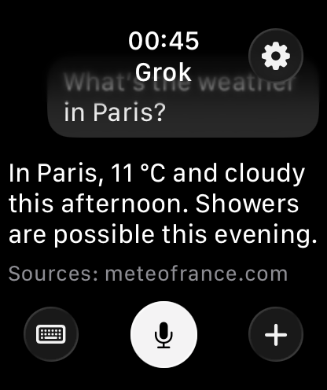
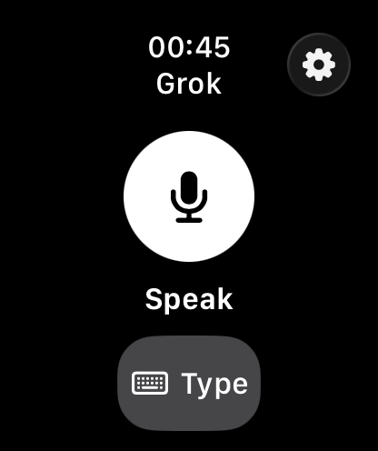
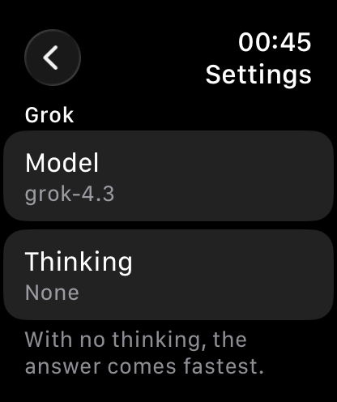

# Grok on Apple Watch

A concept: Grok on the wrist. A watch-only app that talks to Grok with your own SpaceXAI API key. Ask out loud or type, and the answer comes back as text on the watch, never spoken.

<p align="center">
  
  
  
</p>

## What it does

- **Speak, and it's sent.** Opening the app for a new question starts listening. It stops by itself about a second and a half after you stop talking, and SpaceXAI turns the recording into text. watchOS gives apps no speech recognition, and its own text input opens on the keyboard, so the app records and transcribes the question itself.
- **Or type**, with the watch keyboard, Scribble or the iPhone's keyboard.
- **The answer streams in**, short and written for a small screen. While Grok works, the watch shows what it's doing ("Thinking", "Searching the web") and taps your wrist when the answer is done.
- **Current facts get searched.** Grok's training ends before today, so anything about the present (who holds an office, news, sports, weather, prices) goes through a web search first, with the sources under the answer.
- **Lower your wrist** and nothing is lost: the answer finishes in the background and arrives as a notification.
- **Follow-up questions** keep the context. After an hour away the app starts a new conversation, with the last one a tap away.
- **English and French.** Grok replies in the watch's language unless you ask in another one.

## What you need

- An Apple Watch on watchOS 11 or later. The app was built and tested on watchOS 27.
- A Mac with Xcode. The project was made with Xcode 27.
- An Apple developer account. Apps installed from Xcode run until their provisioning profile or signing certificate ends: up to a year with the paid Apple Developer Program, much less with a free account. The app reminds you a week, two days and the evening before.
- A SpaceXAI API key, from [console.x.ai](https://console.x.ai).

## Setting up

1. Put your team ID in `Config/Local.xcconfig`, which git ignores:

   ```
   DEVELOPMENT_TEAM = ABCDE12345
   ```

2. Pair the watch with the Mac for development (below), keep it on your wrist and unlocked, then install:

   ```bash
   ./install-on-watch.sh
   ```

3. Copy your API key on the Mac, then send it to the watch:

   ```bash
   ./install-key.sh
   ```

   It reads the key from the clipboard without showing it, checks it with SpaceXAI (listing models is free), copies it into the app's own folder on the watch and opens the app, which moves it into the watch's Keychain and deletes the file. Typing the key on the watch works too: "Add key", then the iPhone's offer to type for the watch.

4. Allow notifications when the watch asks. They carry answers that land with your wrist down, and the reminders before the install ends.

### Pairing a watch on watchOS 27

1. The iPhone must be paired with the Mac and in Developer Mode. A phone Xcode has never seen does not show up at all: `xcrun devicectl manage pair --device <its UDID>` makes it ask to trust the Mac, then turn on Settings > Privacy & Security > Developer Mode on the iPhone.
2. watchOS 27 does not pair with the Mac through the iPhone. Open Device Hub (Xcode 27's device manager), choose File > Pair Nearby Device…, and leave it waiting. Put the watch on the same Wi-Fi as the Mac (turning Bluetooth off on the iPhone makes it switch), then on the watch open Settings > Privacy & Security > Developer Mode, turn it on and pair with the Mac. Turn Bluetooth back on afterwards.
3. The install script registers the watch with your developer account on its first run.

If the script can't install, open `GrokWatch.xcodeproj` in Xcode, pick the watch as the destination and press Cmd-R. Reinstalling keeps the key and the settings.

## What it costs

Everything is billed to your SpaceXAI key: each answer at the model's own price (Settings shows what the watch spent this month), about $0.005 per web search, about $0.10 per X search (off by default), and about $0.10 per hour of transcribed audio.

## Privacy

- The key lives only in the watch's Keychain (this device only, not backed up) and is only ever sent to `api.x.ai`.
- Requests go with `store: false`, so conversations are not kept on SpaceXAI's side. They stay on the watch.
- A recording is deleted from the watch as soon as it is transcribed.
- No analytics, and no server other than SpaceXAI's.

## Building and testing

```bash
xcodebuild -project GrokWatch.xcodeproj -scheme GrokWatch -configuration Debug -destination 'generic/platform=watchOS Simulator' -derivedDataPath build/dd build
```

```bash
Tests/run.sh
```

`Tests/run.sh` runs the logic tests on the Mac (stream parsing, API errors, model choice, answer text, conversations, install dates and reminders, spending, the prompt and the speech upload) and fails if an em or en dash slipped into the sources.

Debug builds take launch arguments for the simulator: `-GrokWatchSimulated YES` (a pretend Grok: nothing is sent and nothing is billed), `-GrokWatchKey <key>` (a key for that run only), `-GrokWatchAsk "<question>"`, `-GrokWatchDemo YES`, `-GrokWatchFresh YES`, `-GrokWatchFakeExpiryDays 5`, `-GrokWatchPage settings|settings-bottom|key` and `-GrokWatchNoAutoDictation YES`. Recording in the simulator depends on the Mac's own microphone, so voice is best tried on a real watch.

## How it works

- `Grok/GrokClient.swift`: the Responses API (`POST https://api.x.ai/v1/responses`), streamed. Web and X search are SpaceXAI's server-side tools, capped at three turns. If the chosen model is retired, the app switches to grok-4.3 (or the cheapest text model listed) and asks again.
- `Grok/Prompt.swift`: the instructions sent with every question: today's date and time, short answers for a small screen, and a search first for anything current.
- `Chat/ChatModel.swift`: the conversation, the background time (`performExpiringActivity`), and the tap or the notification when an answer lands.
- `System/VoiceRecorder.swift` and `Grok/SpeechClient.swift`: the microphone (AAC, 16 kHz mono, stopping on silence measured against the room's own noise, opened off the main thread with a 4 second limit) and SpaceXAI's speech to text (`POST /v1/stt`, with the `language`, `format` and `keyterm` fields before the file).
- `System/KeyImport.swift` and `install-key.sh`: the key from the Mac's clipboard into the watch's Keychain.
- `System/ProvisioningProfile.swift` and `System/InstallExpiry.swift`: the end date from the embedded profile and its certificates, and the reminders.
- `Localizable.xcstrings` and `InfoPlist.xcstrings`: the French translation.

The commit history shows the app being built, one step at a time.

This is an independent concept, not affiliated with or endorsed by SpaceXAI. Grok and SpaceXAI belong to their owners.
